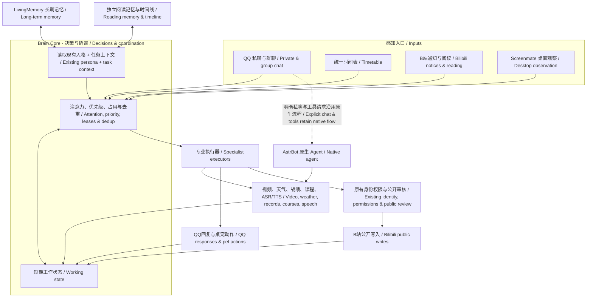

# Xiaojing · AstrBot Fish Capabilities

Configure your own city, school and timezone: see [generic deployment settings](docs/generic-settings.en.md). The public package includes no personal school hostname or default weather city.

[中文](README.md) | [English — 完整翻译](README.en.md)

**0.9.0** · Shared Brain Core for QQ, Bilibili and autonomous companionship. Deploy on a compatible ARM64 Android tablet or computer; model APIs can run in the cloud. Coding assistants are deployment/maintenance aids and do not need to stay connected for normal operation.

[Download source](https://github.com/FigaroGao/astrbot-fish-capabilities/archive/refs/heads/main.zip) · [Start here](docs/getting-started.en.md) · [Choose capabilities](docs/capabilities.en.md) · [Illustrated examples](docs/examples.en.md) · [Core changes](docs/brain-core.en.md)

All feature switches default to off; configure your own identity and services. This repository is a multi-component source project, not a repository-root plugin installer.

## Brain overview



## Example: a video becomes a conversation


[More examples: preemption, mentions, schedules and silence](docs/examples.en.md)

## Capability navigation

| Entry | Capability | What it does | Setup | Source |
|---|---|---|---|---|
| [fish-brain](docs/capabilities.en.md#fish-brain) | Shared core | Attention, working state, preemption and persona context | [Guide](docs/brain-core.en.md) | [Source](astrbot_plugin_fish_capabilities/services/brain.py) |
| [fish-chat](docs/capabilities.en.md#fish-chat) | Chat and participation | Group intent, silence, backlog merging and segmentation | [Guide](docs/intent.en.md) | [Source](astrbot_plugin_fish_capabilities/services/intent_runtime.py) |
| [fish-memory](docs/capabilities.en.md#fish-memory) | Memory and timeline | Long-term integration, archives, corrections and activity indexes | [Guide](docs/memory.en.md) | [Source](astrbot_plugin_fish_capabilities/services/memory_editor.py) |
| [fish-bili](docs/capabilities.en.md#fish-bili) | Bilibili | Selection, video understanding, topics, comments and dynamics | [Guide](docs/bili-social.en.md) | [Source](astrbot_plugin_fish_capabilities/services/bilibili.py) |
| [fish-val](docs/capabilities.en.md#fish-val) | Mainland VALORANT | WeChat binding, records, incremental sync and daily shop | [Guide](docs/new-capabilities.en.md) | [Source](astrbot_plugin_fish_capabilities/services/valorant.py) |
| [fish-canvas](docs/capabilities.en.md#fish-canvas) | Courses and Canvas | School courses, assignments, announcements and personal progress | [Guide](docs/update-20261029.en.md) | [Source](astrbot_plugin_fish_capabilities/services/course_context.py) |
| [fish-tasks](docs/capabilities.en.md#fish-tasks) | Unified schedule | Natural-language reminders, browsing and maintenance schedules | [Guide](docs/release-0.7.0.en.md) | [Source](astrbot_plugin_fish_capabilities/services/timetable.py) |
| [fish-meme](docs/capabilities.en.md#fish-meme) | Memes and expression | Categorized library, sending opportunities, style references and diagnostics | [Guide](docs/memes.en.md) | [Source](astrbot_plugin_fish_capabilities/services/tone_diagnostics.py) |
| [fish-weather](docs/capabilities.en.md#fish-weather) | Weather and daily tools | configured-city weather and authorized group-record queries | [Guide](docs/getting-started.en.md) | [Source](astrbot_plugin_fish_capabilities/services/weather.py) |
| [fish-speech](docs/capabilities.en.md#fish-speech) | Speech | Speech recognition and optional TTS adapters | [Guide](docs/update-20261031.en.md) | [Source](astrbot_plugin_fish_capabilities/services/asr.py) |
| [fish-mail](docs/capabilities.en.md#fish-mail) | Mailbox | Local letters, replies, read receipts and connection status | [Guide](docs/cold-memory.en.md) | [Source](astrbot_plugin_fish_capabilities/services/sister_mail.py) |
| [fish-recovery](docs/capabilities.en.md#fish-recovery) | QQ recovery | Separate recovery manager, bounded relogin and verification stop | [Guide](docs/recovery.en.md) | [Source](recovery/) |

[Screenmate desktop companion](https://github.com/FigaroGao/Xiaojing-Screenmate)

## Tests and sources

```bash
python -m pip install -e '.[test]'
python -m pytest -q tests
python -m unittest discover -s recovery -p 'test_*.py'
```

Isolated tests do not replace real-account end-to-end validation. See the [validation record](docs/validation.en.md) for pass counts, device checks and untested cases. Neither HarmonyOS background survival nor unofficial QQ access can be guaranteed permanently stable.

Code is released under [AGPL-3.0](LICENSE); see [NOTICE](NOTICE.md) for third-party sources and asset boundaries. Initiated, deployed and maintained by FigaroGao, with Codex (OpenAI) assisting design, implementation, tests and documentation. Commits retain Codex coauthor credit; this does not imply official OpenAI endorsement.
