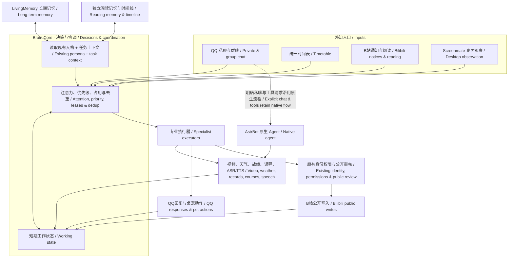
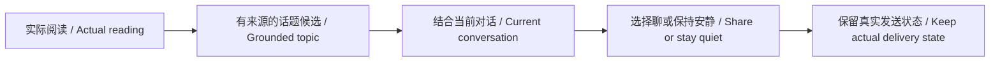

# 小鲸 · AstrBot 大肥鱼能力扩展

城市、学校与时区均由使用者配置，见[通用部署设置](docs/generic-settings.md)。公开包不含个人学校域名或默认天气城市。

**0.9.2 新增：** 固定白名单内的临时行为调节、只读自检与问题写信；不开放自改代码或权限。[行为调节与自检](docs/self-regulation.md)。

**0.9.1 新增：** B站扩展读取、稍后再看、关注、转发和图库图文动态；掌瓦分组统计、趋势、本地历史与商店愿望单。[完整功能与开关说明](docs/bili-valorant-expansion.md)。本批仅代码与Mock回归，未做真实账号联调或平板部署。

[中文](README.md) | [English — 完整翻译](README.en.md)

**0.9.2** · 让QQ、B站和自主活动共用一套主脑。可部署在兼容的ARM64安卓平板或电脑上，模型使用云端API；DSH、Codex等辅助部署和维护，日常运行不需要它们持续连接。

[下载源码](https://github.com/FigaroGao/astrbot-fish-capabilities/archive/refs/heads/main.zip) · [从零部署](docs/getting-started.md) · [按功能安装](docs/capabilities.md) · [示例图](docs/examples.md) · [主脑改动](docs/brain-core.md)

分享版开关默认关闭，需配置自己的身份和服务。本仓库包含多个组件，不能把仓库根目录直接当成单个插件安装。

## 主脑总图



## 示例：把视频变成聊天话题



[更多示例：让路、@回复、统一日程与群静音](docs/examples.md)

## 功能导航

| 入口 | 分类 | 主要功能 | 配置指南 | 源码 |
|---|---|---|---|---|
| [fish-brain](docs/capabilities.md#fish-brain) | 共享主脑 | 注意力、工作状态、抢占、人格上下文 | [指南](docs/brain-core.md) | [源码](astrbot_plugin_fish_capabilities/services/brain.py) |
| [fish-chat](docs/capabilities.md#fish-chat) | 聊天与接话 | 群聊意图、静音、积压合并与分段 | [指南](docs/intent.md) | [源码](astrbot_plugin_fish_capabilities/services/intent_runtime.py) |
| [fish-memory](docs/capabilities.md#fish-memory) | 记忆与时间线 | 长期记忆适配、冷档、纠错、活动索引 | [指南](docs/memory.md) | [源码](astrbot_plugin_fish_capabilities/services/memory_editor.py) |
| [fish-bili](docs/capabilities.md#fish-bili) | B站 | 选片、视频理解、话题、评论与动态 | [指南](docs/bili-social.md) | [源码](astrbot_plugin_fish_capabilities/services/bilibili.py) |
| [fish-val](docs/capabilities.md#fish-val) | 掌瓦 | 微信绑定、战绩、增量记录与每日商店 | [指南](docs/new-capabilities.md) | [源码](astrbot_plugin_fish_capabilities/services/valorant.py) |
| [fish-canvas](docs/capabilities.md#fish-canvas) | 课程与Canvas | 学校课程、作业、公告与个人进度 | [指南](docs/update-20261029.md) | [源码](astrbot_plugin_fish_capabilities/services/course_context.py) |
| [fish-tasks](docs/capabilities.md#fish-tasks) | 统一时间表 | 自然语言提醒、定时刷站与维护任务 | [指南](docs/release-0.7.0.md) | [源码](astrbot_plugin_fish_capabilities/services/timetable.py) |
| [fish-meme](docs/capabilities.md#fish-meme) | 表情与语气 | 分类图库、发送机会、表达参考与诊断 | [指南](docs/memes.md) | [源码](astrbot_plugin_fish_capabilities/services/tone_diagnostics.py) |
| [fish-weather](docs/capabilities.md#fish-weather) | 天气等日常工具 | 默认城市天气、授权群记录等确定性查询 | [指南](docs/getting-started.md) | [源码](astrbot_plugin_fish_capabilities/services/weather.py) |
| [fish-speech](docs/capabilities.md#fish-speech) | 语音 | 语音识别与可选TTS适配 | [指南](docs/update-20261031.md) | [源码](astrbot_plugin_fish_capabilities/services/asr.py) |
| [fish-mail](docs/capabilities.md#fish-mail) | 信箱 | 本地留言、回信、已读与连接状态 | [指南](docs/cold-memory.md) | [源码](astrbot_plugin_fish_capabilities/services/sister_mail.py) |
| [fish-recovery](docs/capabilities.md#fish-recovery) | QQ恢复 | 独立恢复器、有限重登与人工验证停止 | [指南](docs/recovery.md) | [源码](recovery/) |

[Screenmate桌面陪伴：独立仓库](https://github.com/FigaroGao/Xiaojing-Screenmate)

## 目录和安装原则

主插件在 `astrbot_plugin_fish_capabilities/`，应复制到实际 AstrBot 的 `data/plugins/` 中。本仓库还含工具、恢复器和补丁，**不要把仓库根目录当单个 AstrBot 插件安装**。依赖要装进运行 AstrBot 的同一个 Python 环境。参考框架版本 AstrBot 4.29.1、NapCat 4.18.38，其他版本需检查适配。

`examples/config.disabled.json` 是全关模板，不是可直接运行的私人配置。B站、掌瓦、语音、公开写入分别启用，不会因打开总开关自动获得账号权限。

## 其他文档

[QQ恢复](docs/recovery.md) · [群聊控制](docs/group-controls.md) · [B站互动](docs/bili-social.md) · [已有能力配置](docs/new-capabilities.md) · [记忆时效](docs/memory-policy.md) · [表情](docs/memes.md)。旧版指南中的固定时间和旧限制以0.7.0迁移说明及本机实际配置为准。

## 测试与来源

```bash
python -m pip install -e '.[test]'
python -m pytest -q tests
python -m unittest discover -s recovery -p 'test_*.py'
```

隔离测试不能代替真实账号端到端验证。具体通过数量、设备检查与未实测事项见[验证记录](docs/validation.md)。HarmonyOS 后台存活和非官方QQ接入均不能保证永久稳定。

代码按 [AGPL-3.0](LICENSE) 发布，第三方来源及素材边界见 [NOTICE](NOTICE.md)。由 FigaroGao 发起、部署与维护；Codex（OpenAI）协助设计、实现、测试与文档。提交保留 Codex 共同作者署名，不代表 OpenAI 官方认证。


自动表达学习：小鲸按新私聊记录自行增量整理表达习惯，按场景少量应用，可暂停/拒绝/重置。 [Guide / 说明](docs/style-learning.md)
