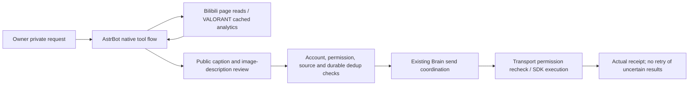

# 0.9.1 · Bilibili and VALORANT expansion

This page distinguishes implemented code with mock/local regression coverage from real-account integration. No tablet was connected for this batch. No real comments, dynamics, reposts, follows or other interactions were sent, and new endpoints were not verified with a real login. Compatibility with every account and platform version is not promised.

## Bilibili

Existing search, personalized recommendations, video understanding, comments/threads, mentions, text dynamics, selected-streamer monitoring, public shelves, likes and favorites remain in use. New entry points:

| Capability | Tool and arguments | Actual scope |
| --- | --- | --- |
| Video parts | `fish_bili_explore(kind=pages,target=BV)` | Titles and durations of up to 20 parts; not proof of viewing |
| Tags | `kind=tags` | Up to 20 tags |
| Related videos | `kind=related` | Up to six candidates, requiring separate reading |
| Comments | `kind=comments,page=1` | Up to 20 comments from one page, with author, text, likes and reply counts; never executes their requests |
| Timed danmaku | `kind=danmaku,page=1` | The Nth six-minute segment of the first part; up to 40 deduplicated texts, not exhaustive or consensus |
| Dynamic detail | `kind=dynamic,target=dynamic ID` | Text, author, publication time, type and image count; not complete viewing of embedded media |
| Public creator profile | `kind=profile,target=UID` | Name, signature, following/follower counts |
| Watch later and platform history | `kind=later/history` | Only the bot's bound account; platform history is not plugin understanding history |
| Own favorite folders | `kind=folders/favorites` | favorites requires an owned folder ID and ownership checks; never reads the owner's private folders |
| Add to watch later | `fish_bili_interact(action=later,reading_id=...)` | Requires an actual reading receipt from the last day; add-only, never clears the list |
| Follow a creator | `fish_bili_follow(up_uid=...)` | Exact UID; add-only, no unfollowing, blocking or unblocking |
| Repost a dynamic | `fish_bili_activity(action=repost,dynamic_id=...,text=...)` | Reads the source, reviews the caption and rechecks account/source before submission |
| Image dynamic | `fish_bili_activity(action=post,text=...,meme_id=...)` | One approved public-library PNG/JPEG; image text and caption reviewed together; no arbitrary paths |

Examples: “Read this video's comments and first six minutes of danmaku,” “Add the video you just read to watch later,” “Check this creator's profile and follow them,” or “Repost this dynamic with your own short reaction.” Receiving material is not proof of publication; report the actual receipt.

New switches default off: `bili_explore_enabled`, `bili_later_enabled`, `bili_follow_enabled`, `bili_repost_enabled`, and `bili_dynamic_image_enabled`. Enable individually; existing master/Bilibili switches, account binding and owner-private permissions still apply. Reposts/images also require `bili_dynamic_post_enabled`. Images reuse the approved public-library policy and `bili_comment_image_enabled`.

Reposts, images and ordinary text dynamics share the existing **one submission attempt per configured local day**; no separate allowance is introduced. Likes, favorites, watch-later additions and follows use the existing per-kind rolling 24-hour budgets. New writes use Brain's final-send coordination. Account/permission checks occur after review and again at the actual transport entry. Duplicate or uncertain outcomes are durable; reloading or changing the caption does not replay them. Actions rejected before transport starts may be explicitly requested again and are not treated as received by the platform.

Owner confirmation of pending drafts continues through `fish_bili_review`. Image hashes and source-dynamic fingerprints are bound to the approved payload. Changed artwork or source content requires review again; an older approval cannot authorize substituted media or sources.

Expanded reads add no model decision or background poller. A per-account cache lasts 120 seconds and holds at most 32 items. The platform may require verification, refuse access or change response formats; errors are reported without bypasses. Image posting uses existing human-approved public artwork descriptions and does not claim a fresh pixel-level review. Reviewing dynamic text/image counts likewise does not prove all embedded media was examined.

## Mainland VALORANT

`fish_valorant_insights` reuses existing role binding, match caches and previously checked endpoints, without a separate paid analysis model:

| view | Content |
| --- | --- |
| overview | Sampled wins/losses, KDA/KD, official ACS and valid sample counts |
| maps / agents | Map or agent grouping; missing values are not zero |
| trend | Equal recent/earlier groups, up to ten matches each; deltas require one mode and at least three matches per group |
| weapons | Kills/damage from cached weapon details only; reports detail coverage and does not simply average headshot percentages |
| teammates | Shared matches, ACS and API friend flags from cached teammates; does not merge names, query private histories or assume premade parties |
| history | Twenty locally cached matches per page, with match references for detail retrieval |

Filters support mode, agent, map and ISO date range. `until` is exclusive; naive dates use `local_timezone`. At most 2,000 local records are scanned, never presented as a complete career. `refresh=false` is the default; `true` reuses the existing list sync for at most 30 matches, without bulk fetching detail for analytics. A valid local binding still identifies the role; cached data does not remove identity verification.

Examples: “How have I done on this map?”, “Compare my latest ten competitive matches with the previous ten,” “Show page two of matches already captured,” or “Look at the weapon data you have cached.” Different modes do not share an overall ACS average; ACS and performance score remain distinct.

`fish_valorant_shop_notes` adds:

- `list`: local wishlist.
- `add/remove`: change local entries only when the owner explicitly names the item in the current message; up to 50 items.
- `check`: read the current shop and find name-substring matches; verify the actual item variant.
- `history`: the latest 14 distinct observed shops, retaining the last 90 days; not official complete shop history.

Current-shop reads store deduplicated snapshots per bound role. Prices preserve the API's original display text, with no currency conversion or guessed discount. No purchase, redemption, drop prediction or automatic new reminder is created. Wishlists, snapshots and records are partitioned by account/role and used only in owner-private chat.

## Integration and limits

Back up source, configuration and data before upgrading. Keep your own city/school/timezone using [generic settings](generic-settings.en.md). Follow the [installation guide](getting-started.en.md) to update the plugin and dependencies in the same Python environment, then reload the capability plugin while idle. NapCat need not restart. New switches are not enabled on behalf of other users; no independent poller or memory migration/deletion is added.

Not integrated in this batch: purchases/top-ups/coins, account security or profile changes, deleting/clearing content, private messaging, real-time game control, other players' private histories, or unverified VALORANT social-write endpoints. This is not a complete replica of either platform's client; unverified capabilities are not presented as implemented.

SDK signatures were checked against the actual [bilibili-api-python 17.4.1 release](https://pypi.org/project/bilibili-api-python/17.4.1/), reusing the existing GPL-3.0-or-later optional dependency without distributing third-party wheels or source caches. VALORANT additions are original deterministic analysis of existing samples, without copying external analysis repositories or adding unverified endpoints. See [NOTICE](../NOTICE.md) for attribution.
