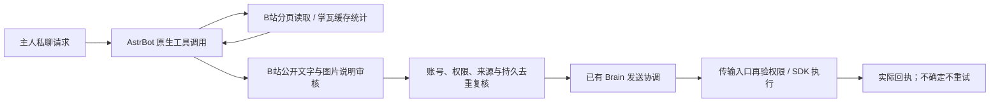

# 0.9.1 · B站与掌瓦扩展

本页区分“已经写入代码并通过 Mock/本地回归”和“真实账号联调”。本批未连接平板，没有发送真实评论、动态、转发、关注或其他互动，也没有使用真实登录态验证新接口。不能据此承诺所有账号和平台版本均可用。

## B站功能

原有搜索、首页推荐、视频理解、评论与楼中楼、@通知、动态文字发布、指定UP直播监测、公开书架、点赞收藏继续复用。新增入口如下：

| 能力 | 工具与参数 | 实际范围 |
| --- | --- | --- |
| 分P目录 | `fish_bili_explore(kind=pages,target=BV)` | 最多20个分P的名称、时长，不等于已看完 |
| 视频标签 | `kind=tags` | 最多20个标签 |
| 相关推荐 | `kind=related` | 最多6条候选，之后仍需单独深读 |
| 评论区 | `kind=comments,page=1` | 单页最多20条，含正文、作者、点赞和回复数量；不自动执行留言 |
| 带时间弹幕 | `kind=danmaku,page=1` | 第一分P的第N个六分钟段，去重最多40条；不是全量或共识 |
| 动态详情 | `kind=dynamic,target=动态ID` | 文本、作者、发布时间、类型及图片数量；不冒充完整看过图/视频 |
| UP公开资料 | `kind=profile,target=UID` | 名称、签名、关注/粉丝数量 |
| 稍后再看、平台历史 | `kind=later/history` | 只读小鲸绑定账号；历史来自平台，不是本插件理解记录 |
| 自己的收藏夹 | `kind=folders/favorites` | favorites需自己的夹ID，校验夹归属；不读取主人的私密收藏 |
| 加入稍后再看 | `fish_bili_interact(action=later,reading_id=...)` | 需要一天内真实阅读凭据；只添加，不清空 |
| 添加关注 | `fish_bili_follow(up_uid=...)` | 准确UID，只添加；不取关、拉黑或解除拉黑 |
| 转发动态 | `fish_bili_activity(action=repost,dynamic_id=...,text=...)` | 读取原动态、审核附言，发送前重新核对账号与原内容 |
| 图文动态 | `fish_bili_activity(action=post,text=...,meme_id=...)` | 一张已批准公开图库PNG/JPEG；图中文字和正文合审，不接受任意文件路径 |

示例：“看看这条视频评论区和前六分钟的弹幕”“把刚读过的视频放进稍后再看”“看看这个UP的资料，关注他”“转发这条动态，配一句你自己的感想”。工具调用收到资料不等于完成发布；按实际回执回复。

新增开关默认为关闭：`bili_explore_enabled`、`bili_later_enabled`、`bili_follow_enabled`、`bili_repost_enabled`、`bili_dynamic_image_enabled`。分别按需开启，仍需原有总开关、B站开关、账号绑定和主人私聊权限。转发/图文还需 `bili_dynamic_post_enabled`；图文复用公开图库审核规则和 `bili_comment_image_enabled`。

转发、图文和原文字动态共用原有**配置时区每天最多一次发送尝试**，没有新建另一套免费额度；点赞、收藏、稍后再看、关注按各类原有滚动24小时预算执行。所有新写入接入 Brain 的最终发送协调；账号/权限在审核后以及实际传输入口再核对。重复或不确定结果持久化，重载后不换文案重发。主脑在传输开始前拒绝的动作可明确重新请求，不当成平台已收到。

主人确认待审草稿时沿用 `fish_bili_review`。图库图片哈希与原动态指纹绑定到批准内容；确认后素材或原动态已变化时，重新审核，不能沿用旧批准换图或换来源。

扩展读取没有新增模型判断或后台轮询，采用120秒、最多32项的账号隔离缓存。服务端可能要求验证、拒绝读取或改变数据结构；失败如实返回，不绕过验证。图文发布只使用已有人工批准的公共素材文字说明，不声称重新逐像素识别；转发审核也不能据动态文字/图片数量承诺已审看全部内嵌媒体。

## 掌瓦功能

新增 `fish_valorant_insights`，继续使用现有角色绑定、对局缓存和已核对接口，不另起付费分析模型：

| view | 内容 |
| --- | --- |
| overview | 所选缓存样本的胜负、KDA/KD、官方ACS及有效样本数 |
| maps / agents | 按地图或特工分组，缺失值不当0 |
| trend | 最近与更早等量样本，每组最多10场；同模式且每组至少3场才给差值 |
| weapons | 只汇总已缓存武器详情的击杀/伤害，报告详情覆盖数量，不简单平均爆头率 |
| teammates | 已缓存同队玩家共同出现次数、ACS和接口好友标记；不凭同名合并，不查别人私人历史，不把同队说成组排 |
| history | 本地历史每页20场，通过返回的比赛引用继续查详情 |

支持模式、特工、地图、ISO日期范围筛选。`until`为不包含的上界；无偏移日期按 `local_timezone` 解释。最多扫描2000条本地记录，不称完整生涯；`refresh=false`默认不刷新，`true`只复用现有最多30场列表同步，不为统计批量拉详情。工具仍需本机有效绑定以确定所属角色；离线缓存不等于无需验证身份。

示例：“我最近在这张地图表现怎么样”“只看排位，比较最近十场和前十场”“翻一下以前读过的战绩第二页”“看看已经缓存过的武器数据”。不同模式不混算整体ACS；ACS与表现分继续区分。

新增 `fish_valorant_shop_notes`：

- `list`：查看本地愿望单。
- `add/remove`：主人在本条消息明确给出商品名后增删本地条目，最多50项。
- `check`：读取当前商店，按商品名包含关系找愿望单命中，需核对是否同款。
- `history`：最近14次不同商店观察，保留最近90天；不是官方完整商店历史。

当前商店读取会按绑定角色保存去重快照。价格保留接口原文字段，不换算或猜折扣；不购买、兑换或预测出货，也不自动创建新提醒。愿望单、快照和战绩分账号/角色隔离，只在主人私聊使用。

## 接入与边界

升级前备份插件源码、配置及数据目录，按[通用设置](generic-settings.md)保持自己的城市/学校/时区；按[安装教程](getting-started.md)更新插件和同一Python环境的依赖，空闲时重载能力插件。不需要重启 NapCat。新增开关不替使用者默认开启；不会新增独立轮询器或迁移/删除原记忆。

本批没有接入：充值购买/投币、账号安全与个人资料修改、删除/清空内容、私信收发、游戏内实时控制、他人私人战绩、未核实的掌瓦社交写入接口。不是把B站或掌瓦整个客户端原样复制；平台没有核实的能力不伪装实现。

SDK调用按 [bilibili-api-python 17.4.1发行版](https://pypi.org/project/bilibili-api-python/17.4.1/) 的实际源码签名核对，沿用既有GPL-3.0-or-later可选依赖；不分发第三方wheel或源码缓存。掌瓦扩展为已有样本的原创确定性统计，不复制外部分析仓库代码、不新增未核验端点。许可归属见 [NOTICE](../NOTICE.md)。
