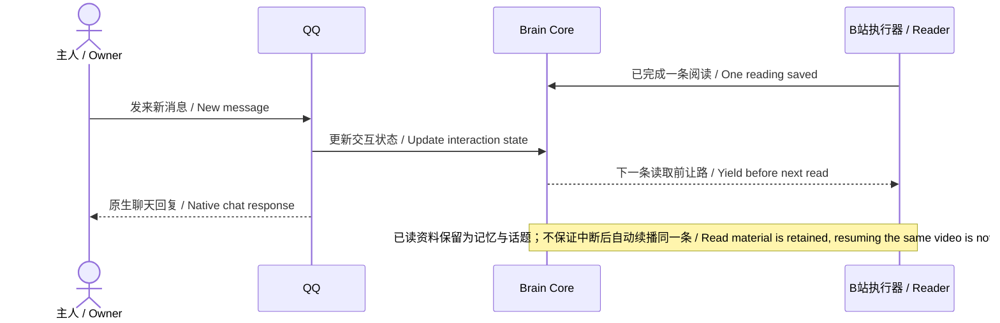
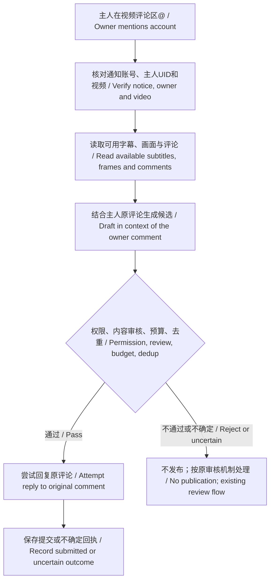
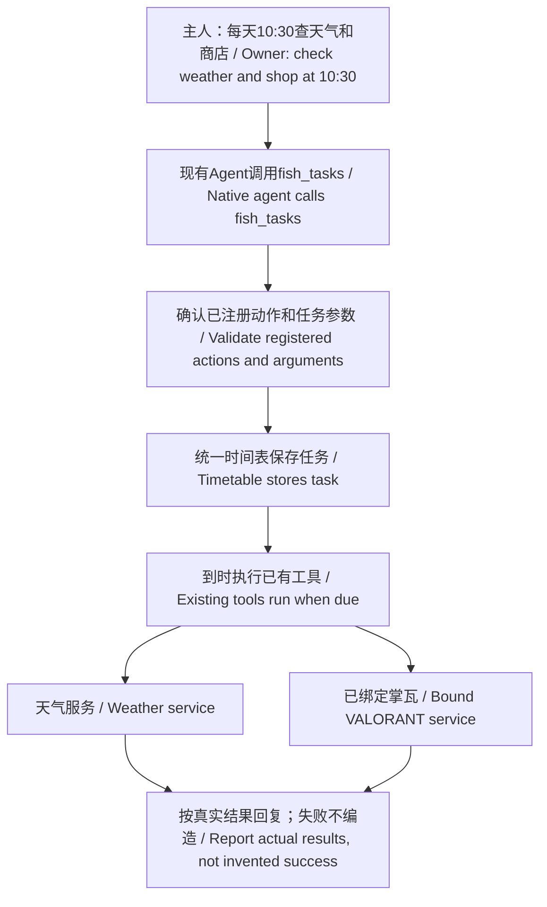
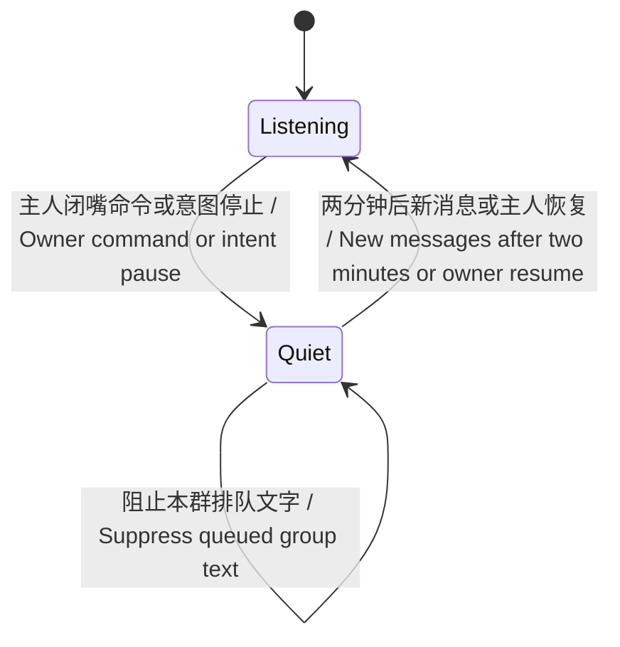

# Illustrated usage examples

[中文](examples.md) | [English](examples.en.md)

These are explanatory diagrams, not screenshots of live conversations or end-to-end test receipts. No real account, private chat, key or game record is included.

## 1. Browsing yields when the owner starts chatting

Reading and chat do not compete as independent senders. Read material is retained; she may choose another topic later or stay quiet.

## 2. Mentioning her on Bilibili: read, then decide

Only verified owner mentions trigger this flow. Submission does not establish public visibility, notification delivery or reading; uncertain writes are not automatically repeated.

## 3. Reusing the schedule: weather and the VALORANT shop

This illustrates task composition, not a task created for repository visitors. VALORANT requires their own binding; natural-language requests still map to registered actions and local configuration.

## 4. Group pause: two minutes in this group

This is group silence, not global shutdown. Previously queued material is not automatically replayed when the timer expires.

[Choose and install capabilities](capabilities.en.md) · [Overall architecture](architecture.en.md)
