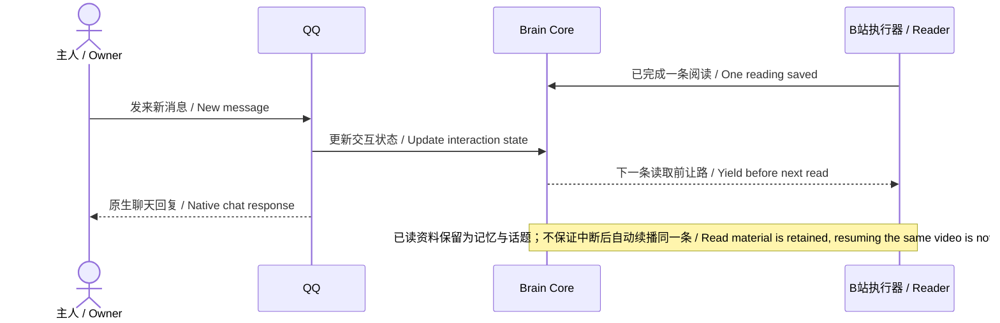
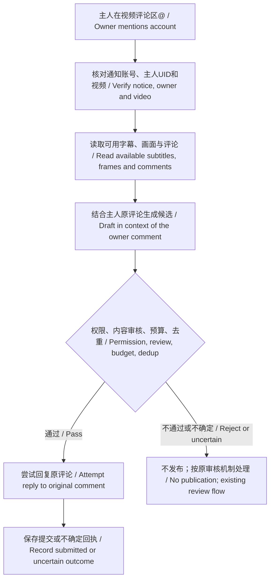
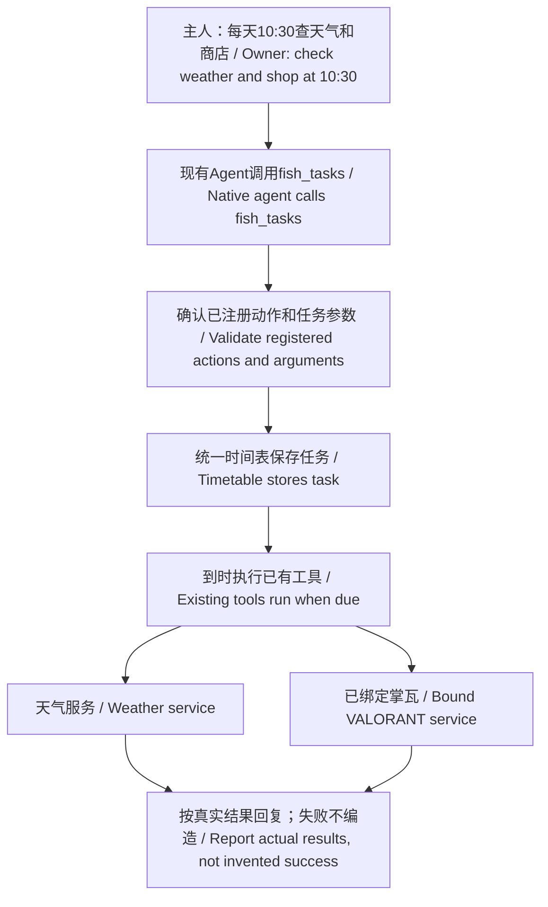
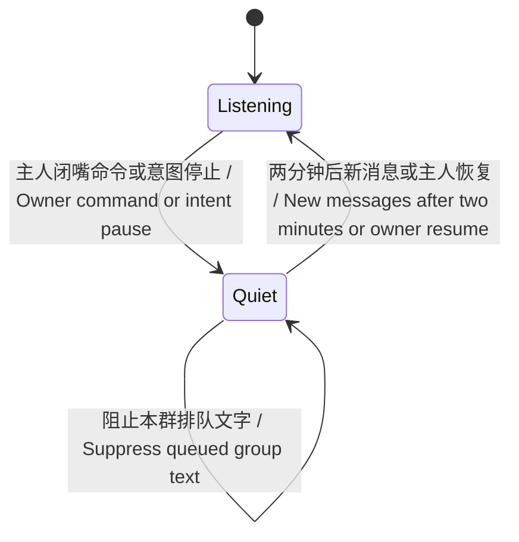

# 使用示例图

[中文](examples.md) | [English](examples.en.md)

以下是机制示意图，不是真实聊天截图或端到端实测回执。不包含真实账号、私聊、密钥或战绩。

## 1. 主人找她时，刷站让路

不是看视频和聊天各自争着发消息。已读内容保留；她之后可以再选话题，也可以安静。

## 2. B站@她：先读，再决定回不回

只有经过核验的主人提及会触发这条流程。提交不等于公开可见、通知送达或已读；不确定时不自动补发。

## 3. 复用日程：天气和掌瓦商店

这是任务组合示意，不是已为访问仓库的人创建了任务。掌瓦要先完成自己的绑定；自然语言请求仍需按现有任务动作和配置落地。

## 4. 群聊暂停：本群两分钟

这张图描述群静音，不是全局停机。既有排队内容不会仅因时间到期就自动补发。

[按功能选择与安装](capabilities.md) · [主脑总图](architecture.md)
