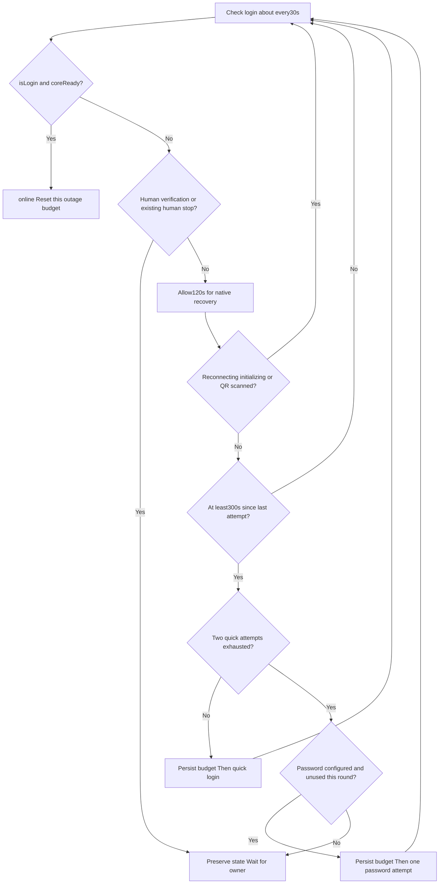

# QQ login recovery: implementation, deployment, and troubleshooting

[中文 — 完整对应版本](recovery.md)

This guide describes the actual repository code:recovery/napcat_recovery.py,recovery/install.py,recovery/ensure_services.py,and astrbot_plugin_fish_host_guard/main.py. The reference is NapCat4.18.38,AstrBot4.29.1,native Termux Python,and Ubuntu proot. It is not a universal QQ login protocol or a strategy of continuously restarting QQ.

## 1. Three layers

| Layer | Responsibility | Outside its responsibility |
| --- | --- | --- |
| Native NapCat recovery | QQ/Worker sessions and reconnection receive time to recover first | The external manager does not reimplement the Worker |
| Native-Termux manager | Checks login about every30 seconds, bounded quick login and optional password fallback | No QQ killing, Worker restart, or Tencent-verification bypass |
| runit + AstrBot guard | runit restarts an exited manager; an independent guard repairs a missing/stale manager or supervisor | No treating model-network failure as logout, resetting login budgets, or revival from outside Android after all Termux processes stop |

QQ login-ready is only the first link. OneBot WebSocket,AstrBot adapters,model APIs,and segmented delivery are separate downstream links. When QQ is online but does not reply, inspect downstream links rather than logging QQ in again.

## 2. State machine and actual timing



From the first confirmed offline time t0,the earliest requests are approximately t0+120 seconds for quick login1,t0+420 for quick login2,and t0+720 for password fallback. Actual timing depends on30-second polling,API duration,and NapCat's in-progress states; these are not precise countdowns. Sending a quick/password request does not establish success:the next cycle still checks status.

Reconnection,initialization,and a scanned QR flow are not interrupted,so waiting can continue instead of forcing immediate recovery. Captchas or wrong-password signals take priority and require a human. Becoming online resets the outage counters; restarting only the manager does not.

## 3. State reference

| phase | Meaning and action |
| --- | --- |
| online | isLogin=true and coreReady=true,not end-to-end messaging validation |
| waiting_native_recovery | Initial wait,cooldown,or an in-progress native state; do not compete with login |
| quick_login_requested | The quick-login budget was reserved before sending; wait for later status |
| password_login_requested | The single password attempt was reserved; wait for later status |
| manual_verification | Captcha,new-device/security verification,or similar signal; automatic attempts stop |
| waiting_scan_password_not_configured | Quick attempts exhausted with no password configured; scan required |
| waiting_manual_login | Fallback exhausted or password endpoint rejected; human handling required |
| account_not_configured | No local QQ account setting; do not guess an account |
| webui_unreachable | API/authentication/local-file/response failure prevents confirmation; this is not proof of QQ logout |

manual_required is a persistent stop flag. The phase can retain the latest request name,so inspect the flag and attempt counts together. needs_human checks needCaptcha,needNewDevice,and known verification,frozen-account,and wrong-password signals in login errors/messages. It cannot guarantee recognition of new unknown errors; review after upgrades.

## 4. Local endpoints and credentials

The manager only connects to127.0.0.1:6099. It reads its own NapCat config/webui.json token,exchanges SHA256(Token + ".napcat") at /api/auth/login for a Credential,and calls /api/QQLogin/CheckLoginStatus,SetQuickLogin,and PasswordLogin. Authentication is cached for about1800 seconds and cleared after failures. Tokens,Credentials,raw API responses,and passwords are not printed.

These are internal NapCat WebUI endpoints for the reference version,not a Tencent-guaranteed stable public API. Do not expose them publicly or copy a real webui.json into the repository. An optional password is entered locally and saved as an MD5 login digest. That digest remains a usable sensitive login credential,not encrypted storage. Account/password files are0600 and directories0700. A password is optional.

Only code=0 with usable status advances the offline state machine. HTTP timeouts,expired authentication,unreachable WebUI,or a wrong path produce webui_unreachable without killing QQ or restarting its Worker.

## 5. Check the environment before installation

The manager and runit use native Termux Python; AstrBot's Ubuntu proot is a different Python environment. Do not install this native service inside Ubuntu. Confirm that NapCat,QQ QR login,and an ordinary AstrBot text reply already work.

```bash
# Native Termux,outside Ubuntu
pkg install python termux-services termux-tools
termux-wake-lock
```

Review HOME and WEB at the top of recovery/napcat_recovery.py. WEB defaults to the napcat proot-distro container and /root/Napcat/opt/QQ/resources/app/app_launcher/napcat/config/webui.json. Adapt differing distribution names,rootfs layouts,or QQ locations first; do not copy someone else's token because the filename matches.

Check response-field compatibility with your NapCat version and back up existing plugins/services. The reference device is HarmonyOS4.2 ARM64,not validation of every Android/HarmonyOS/NapCat release.

## 6. Installation and local commands

Run from the downloaded repository root. Enter the QQ account interactively on the device,not as a command-line argument:

```bash
python recovery/install.py
python ~/.napcat-recovery/manager.py status
sv status "$PREFIX/var/service/fish-recovery"
```

The installer validates native Python,sv,and WEB,and refuses to overwrite an existing service or manager/guard scripts. It copies scripts,writes settings.json and runit run/finish/log scripts,and invokes official service-daemon start and sv up without restarting QQ. The shared installer has not been reinstalled on every device; do not ignore its errors and continue copying.

```bash
# Optional:hidden local entry,never send passwords to the bot or command arguments
python ~/.napcat-recovery/manager.py set-password
python ~/.napcat-recovery/manager.py remove-password
# After official identity verification or a fresh scan,allow a new bounded round
python ~/.napcat-recovery/manager.py resume
```

resume only writes a request marker handled by the service holding the lock. It resets the outage counters and starts a fresh wait,without immediately logging QQ out,restarting it,or generating a QR code. Do not repeatedly resume to evade limits. Phone verification does not guarantee reuse of the old LinuxQQ session; if a scan is still needed,use the local NapCat flow.

## 7. Recovering when the manager itself exits

runit supervises only the manager. Its run script sets native HOME/PREFIX/PATH,removes an unsuitable LD_PRELOAD,and execs Python. On exit,finish records the exit code/signal and waits5 seconds before runit starts the manager again. This is different from logging QQ in again.

The manager holds a single-instance flock on manager.lock and atomically replaces state/budget files via temporary files. A login attempt is saved before the call,preventing endless retries after a request was accepted but the connection timed out and the manager restarted.

Optionally copy astrbot_plugin_fish_host_guard into AstrBot's plugin directory and load it. Every60 seconds it executes native ensure_services.py,checking the manager lock,state.json freshness,and the actual process behind the official runsvdir PID. Missing services invoke the official service-daemon. A locked manager with no state update for180 seconds triggers only a fish-recovery restart.

The guard persists repair budgets before action,at most3 per hour and180 seconds apart. A native host-guard.lock prevents overlap; plugin reload cancels the old check task. It does not control QQ,clear manual_required/login counts,or enable unrelated services. If all Termux or AstrBot processes stop,the guard cannot run. Reopen the original environment or separately design system-level startup; boot autostart is not implemented here.

## 8. Pausing,maintenance,and upgrades

sv down alone can be reversed by the guard. Pause the guard first:

```bash
touch ~/.napcat-recovery/host-guard.pause
sv down "$PREFIX/var/service/fish-recovery"
# Resume after maintenance; neither action logs QQ out
rm ~/.napcat-recovery/host-guard.pause
sv up "$PREFIX/var/service/fish-recovery"
```

For an existing installation,back up the private directory and service scripts. Preserve settings/password/state,do not overwrite real settings with public examples,and do not delete manager.lock to force an unlock. Stop the service,compare old/new code,replace only intended scripts,and resume. This documentation release did not replace the stable manager on the original device. Never upload backups to GitHub.

Python-environment,NapCat-path,and endpoint-field changes require adaptation. Killing an online QQ process is not a recommended trial-and-error method.

## 9. Files and troubleshooting

| File | Purpose |
| --- | --- |
| ~/.napcat-recovery/settings.json | Local account settings,not public |
| password.json | Optional login digest,still a sensitive credential |
| state.json / events.jsonl | Current phase,counts,human flag,and transitions; no raw responses |
| manager.lock / resume.request | Single-instance lock and service-handled resume request |
| host-guard-state.json / host-guard-error.json | Guard state,budget,and error types |
| service-exits.log | Manager exit codes/signals,not all QQ output |
| $PREFIX/var/log/sv/fish-recovery/current | Manager log supervised by svlogd |

```bash
python ~/.napcat-recovery/manager.py status
sv status "$PREFIX/var/service/fish-recovery"
# Inspect locally; do not publish complete logs/private state unchanged
cat ~/.napcat-recovery/host-guard-state.json
tail -n 30 ~/.napcat-recovery/service-exits.log
```

| Symptom | Checks |
| --- | --- |
| Browser WebUI works but manager cannot connect | Native WEB path,permissions,token/authentication,and port6099; cached browser success does not establish current API health |
| Waiting for scanning | Quick-attempt count,password configuration,and human-stop flag; no endless resume |
| Phone verification completed but login still fails | The old session may be invalid; follow local NapCat's fresh scan flow; scan-free login is not guaranteed |
| Process exits immediately after sv up | Native Python/PATH/LD_PRELOAD,service run script,logs,and finish exit records |
| Lock present but stale heartbeat | Allow the guard to check; inspect a stalled service without immediately exiting QQ |
| A stopped manager returns | Create host-guard.pause before sv down |
| online but no bot reply | OneBot WebSocket,AstrBot platform logs,tool errors,model API,and reply rules,not repeated QQ login |
| Closing the browser appears to stop services | Inspect Termux processes and OS background limits; simultaneous events do not establish browser causality |

HarmonyOS may still clear processes. Check device-version-specific Termux startup management,battery optimization,wake lock,and networking. Exposing WebUI publicly is not a fix. Use an already-authenticated private SSH/network for remote access; this project does not deploy a public recovery endpoint or phone pushes.

## 10. Evidence and limitations

There are18 recovery tests:12 manager state-machine tests and6 guard tests. All use temporary directories,mocked interfaces,and controlled command substitutes,without real QQ,password reads,or process signals. Coverage includes online reset,initial wait,not-ready status,native recovery non-interference,2 quick+1 password attempt,no-password scanning,persist-before-timeout budgets across restarts,human stops,API failure,missing accounts,cooldown,and missing/stale services,pausing,and repair budgets.

Earlier on-device checks verified runit restarting an individually terminated manager and restoration after a missing supervisor while QQ stayed running. A read-only2026-10-25 check found manager online and guard healthy,with the manager body matching the public source. The user reports recent stable operation. These observations are not a guarantee of permanent connectivity on every device.

Tests did not deliberately trigger server-side QQ logout,exercise a real password fallback,manufacture Tencent risk verification,reboot the device,or automatically validate every full recovery chain. Human acceptance should check:QQ online and ready → OneBot connected → AstrBot actually receives a normal message → the model replies and segmentation/delivery work. The first step is not complete success.

```bash
python -m unittest discover -s recovery -p 'test_*.py'
```

Upstream references:https://github.com/NapNeko/NapCatQQ ,https://github.com/AstrBotDevs/AstrBot ,https://github.com/termux/termux-services . Recheck interfaces and environment after upgrades; the reference versions are not a claim about all current versions.
