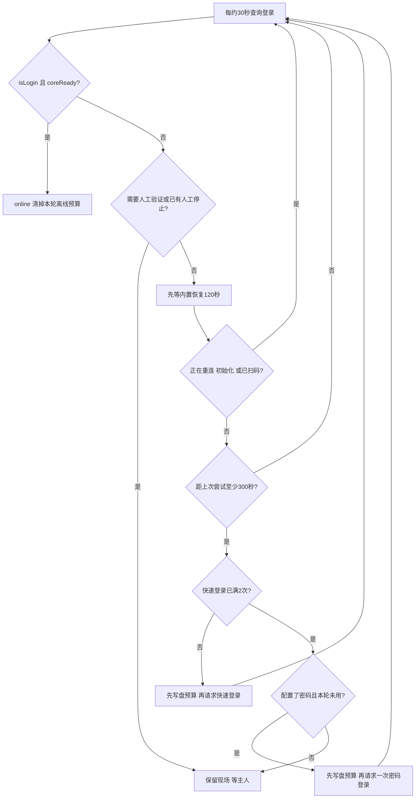

# QQ掉线重登：实现、部署与排障

[English — 完整翻译](recovery.en.md)

本指南对应仓库里的真实代码：recovery/napcat_recovery.py、recovery/install.py、recovery/ensure_services.py、astrbot_plugin_fish_host_guard/main.py。参考NapCat4.18.38、AstrBot4.29.1、原生Termux Python与Ubuntu proot。它不是任意版本通用的QQ登录协议，也不是靠持续重启QQ保持在线。

## 1. 三层分工

| 层 | 做什么 | 不负责什么 |
| --- | --- | --- |
| NapCat内置恢复 | QQ/Worker本身的会话与重连，优先给它处理时间 | 外部恢复器不重复实现Worker |
| 原生Termux恢复器 | 每约30秒读登录状态；有界快速登录与可选密码回退 | 不杀QQ、不重启Worker、不绕过腾讯验证 |
| runit + AstrBot看守 | runit拉起退出的恢复器；独立看守修复缺失/陈旧恢复器或服务管理器 | 不把模型网络异常当掉线，不重置登录预算，不在整个Termux退出后从Android外复活 |

QQ登录ready只是第一段链路。OneBot WebSocket、AstrBot平台适配器、模型API及分段发送是后续独立环节。QQ在线但不回复，应查后续环节，不触发QQ重登。

## 2. 状态机与实际时间线



从第一次确认离线t0开始，最早约t0+120秒快速登录第1次、t0+420秒第2次、t0+720秒密码回退。实际受30秒轮询、API耗时和NapCat进行中状态影响，不能当作精确倒计时。快速/密码请求发出不等于登录成功；下一轮仍查状态。

重连、初始化、已扫码进行中时不抢登录，可能持续等待而不立刻强制恢复。验证码或错误密码等随时优先转人工。在线成功后本轮计数归零；仅重启恢复器本身不归零。

## 3. 状态表

| phase | 含义与操作 |
| --- | --- |
| online | isLogin=true且coreReady=true；不是完整消息链路验收 |
| waiting_native_recovery | 在初始等待、冷却或NapCat进行中状态，不竞争登录 |
| quick_login_requested | 已预扣本轮快速登录次数并发请求，等待后续状态 |
| password_login_requested | 已预扣唯一密码尝试，等待后续状态 |
| manual_verification | 已识别验证码、新设备、安全验证等，自动尝试停止 |
| waiting_scan_password_not_configured | 快速次数用完且未配置密码，需扫码 |
| waiting_manual_login | 已用尽回退，或密码接口拒绝，需人工处理 |
| account_not_configured | 缺本机QQ账号设置，不猜账号 |
| webui_unreachable | API/认证/本地文件/响应异常导致无法确认状态；不能据此宣称QQ离线 |

manual_required是持久停止标记。状态文本有时仍保留最近请求phase，应同时看manual_required和次数，不只看一行名称。needs_human检查needCaptcha、needNewDevice以及登录错误/消息中的已知验证、冻结、错误密码信号；未知新错误不能保证都识别，升级后应核对。

## 4. 本地接口与凭据

管理器只连127.0.0.1:6099，读取自己的NapCat config/webui.json取得WebUI Token，用SHA256(Token + ".napcat")向/api/auth/login换Credential，再调用/api/QQLogin/CheckLoginStatus、SetQuickLogin和PasswordLogin。认证缓存约1800秒，失败后清掉缓存重验；不会打印Token、Credential、原始API响应或密码。

这些是参考版本的NapCat WebUI内部接口，不是腾讯保证稳定的开放API。不要把它们暴露到公网，不把真实webui.json复制进仓库。可选密码本地输入后保存MD5登录摘要；它仍相当于可用于登录的敏感凭据，不是加密保管。账号/密码文件权限0600，目录0700。密码设置不是必需项。

只有接口明确返回code=0且取得状态才推进离线状态机。HTTP超时、认证失效、WebUI暂不可达或配置路径不对只记webui_unreachable，不杀QQ或重启Worker。

## 5. 安装前先核对环境

恢复器和runit运行在原生Termux，AstrBot运行的Ubuntu proot是另一套Python环境。不要在Ubuntu里安装此原生服务。先确认NapCat、QQ扫码和AstrBot普通文字回复已经正常。

```bash
# 原生Termux，不在Ubuntu里
pkg install python termux-services termux-tools
termux-wake-lock
```

检查recovery/napcat_recovery.py顶部HOME与WEB。默认WEB指向proot-distro的napcat容器下/root/Napcat/opt/QQ/resources/app/app_launcher/napcat/config/webui.json。发行版名、rootfs布局或QQ目录不同就先改路径，不能凭“文件名一样”复制别人的Token。

检查脚本对自己的NapCat接口响应字段兼容，备份现有插件和服务。参考设备是HarmonyOS4.2 ARM64，不代表所有Android/HarmonyOS/NapCat版本通过验证。

## 6. 安装及本机命令

在已下载的仓库根目录运行，QQ号通过本机交互输入，不放命令行：

```bash
python recovery/install.py
python ~/.napcat-recovery/manager.py status
sv status "$PREFIX/var/service/fish-recovery"
```

安装器验证原生Python环境、sv和WEB路径，拒绝覆盖已有服务或manager/guard脚本。它复制脚本、生成settings.json及runit的run/finish/log脚本，调用官方service-daemon start和sv up；不重启QQ。分享安装器没有在每台设备重装验证，不能忽略报错继续复制。

```bash
# 可选，本机隐藏输入，不把密码发给机器人或写入命令参数
python ~/.napcat-recovery/manager.py set-password
python ~/.napcat-recovery/manager.py remove-password
# 完成官方身份验证或重新扫码后，允许新一轮有限尝试
python ~/.napcat-recovery/manager.py resume
```

resume只放一个请求标记，由持锁的服务处理。它重置本轮次数并重新计时等待，不立即退出、重启或扫码QQ；不要反复resume来规避次数限制。手机完成腾讯验证也不保证旧LinuxQQ会话可复用，仍需要扫码时应从本机NapCat流程完成。

## 7. 为什么恢复器自己退出后还能回来

runit只托管恢复器进程，run设置原生HOME/PREFIX/PATH、清掉不合适的LD_PRELOAD并exec Python。恢复器退出后finish记录退出码/信号并等5秒，再由runit拉起；这和重新登录QQ不是同一个动作。

恢复器通过manager.lock的flock保持单实例，状态和尝试预算先写临时文件再原子替换。关键登录调用前就写次数，避免请求已被接受但网络超时后服务重启造成无限重试。

可选将astrbot_plugin_fish_host_guard复制到AstrBot插件目录并加载。它每60秒执行原生ensure_services.py，检查manager锁、state.json更新时间和官方runsvdir PID对应的实际进程。缺失时调用官方service-daemon启动服务；恢复器持锁但超过180秒不更新时，只重启fish-recovery。

看守先保存修复预算，每小时最多3次、至少隔180秒；原生host-guard.lock避免重入，插件重载取消旧检查任务。不控制QQ，不清掉manual_required或登录次数，不擅自启用其他服务。整个Termux或AstrBot都停掉时看守不能执行，需要重新打开原环境或另行设计系统级自启；本项目未实现开机自启。

## 8. 暂停、维护与升级

只执行sv down但不暂停看守，可能被看守重新拉起。先暂停再维护：

```bash
touch ~/.napcat-recovery/host-guard.pause
sv down "$PREFIX/var/service/fish-recovery"
# 完成维护后恢复；这两个动作都不退出QQ
rm ~/.napcat-recovery/host-guard.pause
sv up "$PREFIX/var/service/fish-recovery"
```

升级已有安装时先备份私有目录和服务脚本，保留settings/password/state，不复制公开示例覆盖真实设置，不删除manager.lock文件来试图强制解锁。停止服务后比较新旧代码，再替换需要升级的脚本并恢复；本次文档发布没有替换原设备稳定运行的恢复器。不要把备份放进GitHub。

不同Python环境、NapCat路径或API字段变动属于适配工作；不推荐对在线QQ直接试错杀进程。

## 9. 文件与排障

| 文件 | 用途 |
| --- | --- |
| ~/.napcat-recovery/settings.json | 本机账号设置，不公开 |
| password.json | 可选登录摘要，仍是敏感凭据 |
| state.json / events.jsonl | 当前phase、次数、人工标记与状态变化；不输出原始响应 |
| manager.lock / resume.request | 单实例与由服务处理的恢复请求 |
| host-guard-state.json / host-guard-error.json | 看守状态、预算与错误类型 |
| service-exits.log | 恢复器退出码/信号，不是QQ所有日志 |
| $PREFIX/var/log/sv/fish-recovery/current | svlogd管理的恢复器运行日志 |

```bash
python ~/.napcat-recovery/manager.py status
sv status "$PREFIX/var/service/fish-recovery"
# 只在本机查看，不把完整日志/私有状态原样发布
cat ~/.napcat-recovery/host-guard-state.json
tail -n 30 ~/.napcat-recovery/service-exits.log
```

| 现象 | 排查顺序 |
| --- | --- |
| WebUI能打开但恢复器不可达 | 原生WEB路径、文件权限、Token/认证和6099端口；浏览器缓存成功不代表当前API正常 |
| 正在等扫码 | 快速次数、密码是否配置、人工标记；不要无限resume |
| 手机完成验证仍不登 | 原会话可能失效，按本机NapCat提示重新扫码；不保证免扫码 |
| sv up后立刻没进程 | 原生Python/PATH/LD_PRELOAD、服务run、日志和finish退出记录 |
| 恢复器有锁但心跳旧 | 等看守检查；先查服务是否卡住，不直接退出QQ |
| 主动停止又回来 | 先放host-guard.pause，再sv down |
| online但机器人不答 | OneBot WebSocket、AstrBot平台日志、工具错误、模型API与接话规则；不是重复QQ登录 |
| 浏览器关闭服务也停 | 查Termux进程和系统后台限制，不能凭同时发生认定浏览器是根因 |

HarmonyOS后台策略仍可能清理进程，应按设备版本检查Termux启动管理、电池优化、唤醒锁和网络。公开WebUI端口不是修复办法；如需远程访问使用自己已经认证的SSH/私网，项目不自带公网恢复入口或手机推送。

## 10. 验证证据和边界

本次恢复测试共18项：12项管理器状态机、6项看守。全部使用临时目录、模拟接口和受控命令替身，不接真实QQ、不读密码、不发进程信号。覆盖在线复位、初始等待、未ready不算在线、内置恢复不竞争、2次快速+1次密码、无密码扫码、超时前预算落盘与重启不清零、验证停止、接口失败、缺账号、冷却，以及缺失/陈旧服务、暂停和看守预算。

原设备过去验证过仅结束恢复器后runit拉起、以及服务管理器缺失时恢复；QQ实例保持。2026-10-25只读复查恢复器online、看守healthy，主体代码与公开版一致。用户反馈近期运行稳定。这些证据不构成任意设备永不掉线保证。

没有主动触发QQ服务端掉线、实测真实密码回退、制造腾讯风控、整机重启或自动完成每次恢复后的完整链路验收。人工验收顺序应为：QQ在线且ready → OneBot连接正常 → AstrBot实际收到正常消息 → 模型成功回复且分段发送正常。不要将第一步当全部成功。

```bash
python -m unittest discover -s recovery -p 'test_*.py'
```

参考上游：https://github.com/NapNeko/NapCatQQ ，https://github.com/AstrBotDevs/AstrBot ，https://github.com/termux/termux-services 。升级后重新核对接口和运行环境，不把本文参考版本称为当前所有版本。
