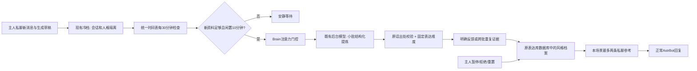

# 自动表达学习 / Continuous expression learning

## 中文

这是小鲸自己运行的后台流程，不需要Codex持续在线或主人逐批传话；不训练模型权重，不改人格主体、权限、LivingMemory事实或既有聊天。

### 数据流

- 默认每半小时检查，有至少4条可用新主人消息、最近10分钟没有主人私聊、Brain空闲才分析。每小时最多一次，默认每天最多4次（含失败/取消），每次最多40个片段、每段240字，输出上限1200 token。轮询等待不调用模型；沿用后台提供商及用量记录，真实分析仍按该提供商计费。
- 首次只看最近7天内最后120个本地片段；之后按持久游标增量读取，不每轮回读全部历史。仅使用已捕获、非导入的绑定主人私聊文本。转发展开、图片、群聊、公开评论不自动当教材；助手草稿明确标记未证明送达或获认可，不能作为偏好证据。
- 借鉴按场景整理表达参考、显式反馈更新偏好、控制不相关记忆使用。模型只提出场景、长度/开场/建议/提问/结构/幽默/亲近程度等固定维度，程序核对真实主人原话。自由生成的提示词、身份、隐私、经历、称呼和权限不能进入自动表达档案。
- 明确且持续适用的表达要求优先，不把“这次简短点”当永久偏好。其他习惯至少需要两批独立来源、三条以上不同主人消息、来源跨度至少6小时。这里只是可撤销的表达假设，不是“主人同意助手的一切”。继续聊天、沉默或哈哈不视为好评。
- 只把本场景最多两条人工写定的表达策略用于私聊，不复制原文、替换人格或机械加语气词。明确反馈优先于推测；当前任务与原人格优先。推测14天到期，明确反馈30天到期；拒绝的维度不自动复活，重置可重新开始。
- 同一表达库数据库保存游标、计数、来源ID、候选支持和版本审计，不另建向量库。来源原文仍在原冷档，档案不重复保存私聊原句。派生私聊提示从B站公开参考采集时排除，不注入群聊或公开身份Prompt。
- 模型只返回JSON、不持工具。后台复用Brain资源预留、忙碌避让与生成后复核；人格/会话、配置、暂停/重置版本或租约变化时不应用旧结果。崩溃后标记过期运行，失败不立即重试，原日预算保留。不发送QQ/B站消息。

### 开启与管理

启用 `learning_enabled`、`cold_archive_enabled`、`timetable_enabled`、`style_learning_enabled`，配置绑定主人私聊与平台；`style_learning_provider_id`留空复用`bili_provider_id`。`style_learning_daily_limit`默认4，允许1—8；公开安装模板保持关闭。重载后统一时间表只新增一条“私聊表达增量学习”，重复重载不重复建任务；已有被暂停任务不重新启用。

在主人私聊询问“小鲸学到了哪些表达习惯”，调用`fish_style_learning(status)`；说“暂停自动学习”“恢复自动学习”“重置表达学习”，可控制流程。拒绝单个维度先列状态，再明确指定场景与维度。后台管理台 → 表达与观察也可操作。暂停同时停止应用已学风格；重置只清自动表达档案，保留聊天、人格与长期事实。状态含最新进度、运行结果、依据数量、到期和具体策略，不展示秘密或原文。

### 验证边界与参考

程序回归可以验证隔离、出处、状态、预算和真实接线，不能证明未来每句话都自然。固定维度之外的表达仍由原模型和人格决定，语境分类是既有本地规则，可能漏分场景；后续应根据主人实际反馈调整，不堆“人味分数”。默认不开额外批量模型评测。

2026-11-06核对：[fishtalk](https://github.com/Nozzi2455/fishtalk)及[distill.js](https://github.com/Nozzi2455/fishtalk/blob/main/lib/distill.js)（MIT）展示按场景提炼文风包及统计表达的实现；[dsh-fish-tone](https://github.com/MX3a48c5/dsh-fish-tone)（MIT）把表达与性格偏好分层。这里独立Python实现，不复制其语料、黑名单、随机加尾词或源码。研究参考[PAHF](https://arxiv.org/abs/2602.16173)的交互反馈更新、[OP-Bench](https://arxiv.org/abs/2601.13722)对无关、重复及迎合式个性化的区分；没有复现其论文实验，不把本文测试称为论文方法效果验证。

## English

This is Xiaojing's own background workflow. Codex need not remain online, and the owner need not relay batches. It does not train weights or modify the base persona, permissions, LivingMemory facts, or chat history.

The existing cold archive supplies new private messages, scoped to the bound owner and persona. The unified timetable checks every 30 minutes. Analysis requires four usable new owner messages, ten minutes without owner-private activity, and available Brain attention. At most one analysis starts per hour and four per local day by default, including failed/cancelled attempts. Each call receives at most 40 snippets of 240 characters and has a 1,200-output-token limit. Waiting polls do not call a model; real analysis uses the existing metered background provider and usage records.

Bootstrap considers only the last 120 local chunks from the preceding seven days. A durable cursor then advances incrementally. Only captured, non-imported text from the bound owner-private scope is eligible. Expanded forwards, images, groups and public comments are not automatically training material. Assistant drafts are labeled as generated, not proven delivered or approved, and cannot establish preferences.

The extractor proposes only registered scenes and expression dimensions: length, openings, advice, questions, structure, humor and warmth. Evidence must match actual owner text. Arbitrary prompts, identity, private facts, experiences, names and permissions cannot enter the automatic profile. Explicit ongoing expression requests take precedence; a one-off request such as “keep this answer short” does not become permanent. Inferred habits need independent evidence from at least two batches, at least three distinct owner messages, spanning six hours. Silence, continued conversation and laughter are not endorsements of an assistant response.

Only two relevant, prewritten policies are supplied to a private turn. Raw quotes are not copied into response guidance, the persona is preserved, and particles/catchphrases are not inserted mechanically. Current requests and the original persona take priority. Explicit feedback outranks inferred habits. Inferences expire after 14 days and explicit feedback after 30 days. Rejected dimensions do not reactivate automatically; resetting permits a fresh start.

The existing expression-library database stores cursors, accounting, source IDs, support records and revision audits; no new vector store is introduced. Original text remains in the cold archive. Private derived hints are excluded from Bilibili public-reference capture and are not supplied to groups or public identity prompts. The extractor has no tools and returns JSON only. Brain reservations, busy-state checks and post-generation validation remain in use. Changes to persona/session, configuration, pause/reset revision or lease invalidate stale results. Expired runs are marked interrupted; failures are not immediately retried, and daily accounting is retained. The workflow sends no QQ or Bilibili messages.

Enable learning_enabled, cold_archive_enabled, timetable_enabled and style_learning_enabled, and configure the owner-private binding/platform. An empty style_learning_provider_id reuses bili_provider_id. style_learning_daily_limit defaults to four, bounded to one through eight; public templates leave the feature off. Reload adds one unified “private expression learning” task, without duplicating it or re-enabling an existing paused task.

In owner-private chat, fish_style_learning exposes status, pause, resume, reset and rejection of a listed scene/dimension. The authenticated dashboard's Expression and Observations tab provides equivalent controls. Pause also stops applying learned policies. Reset clears automatic expression profiles only, preserving chat, persona and long-term facts. Status exposes progress, run states, evidence counts, expiry and the actual policy, without raw private utterances.

Regression tests establish evidence handling, isolation, state transitions, budget enforcement and wiring, not guaranteed naturalness of future language. The existing local scene classifier can misclassify or miss contexts. Feedback should guide further adjustment; no “humanlikeness score” or bulk paid evaluation is introduced.

References checked on 2026-11-06: fishtalk and its MIT-licensed distill.js organize scene-based expression packs and descriptive statistics; dsh-fish-tone (MIT) separates expression from personality preferences. This Python implementation is independent and copies no upstream corpus, blacklist, random fillers or source code. PAHF informs feedback-based preference updates; OP-Bench informs avoiding irrelevant, repetitive and sycophantic personalization. Their experiments were not reproduced, and our regressions are not evidence of reproducing their research results. Links are provided in the Chinese reference paragraph above.
